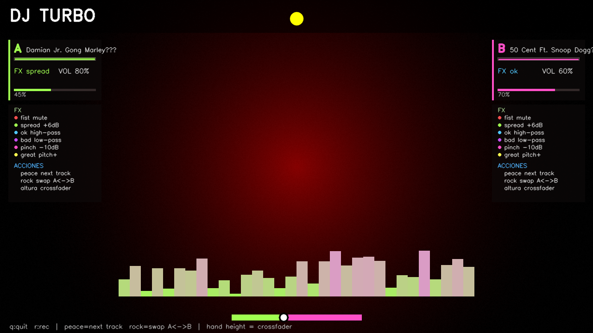

# nexo-dj

> Hand gesture DJ mixer with dual-deck, audio-reactive visuals, background removal, and session recording. Control two tracks with your hands — no controllers, no knobs.



## What this is

A heavily extended fork of the hand-gesture DJ controller originally shared by [@babybeluga__ on X](https://x.com/babybeluga__/status/2043063666287816838). The code base itself came from [PabloWasinger/dj-turbo](https://github.com/PabloWasinger/dj-turbo) (traced back to `belubeluga/dj-turbo`). The original was a proof-of-concept for controlling a single audio track with hand gestures via MediaPipe and Pedalboard.

This fork adds:

- **Dual deck mixing** — load two tracks, mix them in real time. Each hand controls its own deck.
- **Crossfader by hand height** — raise your left hand, deck A gets louder. Raise your right, deck B. Natural, no extra gestures needed.
- **Audio-reactive visuals** — particle system, FFT bars, beat detection, and a dedicated DJ background with MediaPipe selfie segmentation (your image appears over a red-spotlight backdrop).
- **Session recording** — press `r` to record an MP4 with audio + visuals merged via ffmpeg. Ready to post to Instagram or TikTok.
- **Track auto-ciclo** — drop MP3s into the folder and cycle them live with the `peace` gesto.
- **Minimalist sidecards** per deck showing artist, title (auto-cleaned from noisy filenames), gesture, volume, and progress.

Built by [Demian Olmedo](https://agentesnexo.com) for AgentesNexo using Claude Code.

## Requirements

- macOS (tested on M4; Intel should work)
- Python 3.10+
- Webcam
- Two MP3/WAV/M4A files (bring your own — the repo ships with no audio for copyright reasons)
- ffmpeg (`brew install ffmpeg`) for the session recorder

## Install

```bash
git clone https://github.com/YOUR_USERNAME/nexo-dj.git
cd nexo-dj
python3 -m venv myVenv
source myVenv/bin/activate
pip install -r requirements.txt
# if librosa complains about pkg_resources on fresh installs:
pip install "setuptools<81"
```

## Run

```bash
# single-track (legacy mode)
python main.py "your-track.mp3"

# dual-deck mode (this is the fun one)
python main.py "trackA.mp3" "trackB.mp3"
```

The first time you run it, macOS will ask for camera permission. Allow it.

## Gestures

### Effects (apply to the deck of that hand)

| Gesture | Effect |
|---|---|
| Fist | Mute (-100 dB) |
| Spread (palm open) | +6 dB boost |
| OK | High-pass filter (removes bass) |
| Thumb-down | Low-pass filter (removes treble) |
| Pinch | -10 dB |
| Tight pinch | Pitch up +7 semitones |

### Actions

| Gesture | Action |
|---|---|
| Peace sign, left hand | Load next track into deck A (cycles through audio files in the folder) |
| Peace sign, right hand | Load next track into deck B |
| Rock sign (index + pinky up) | Swap decks A ↔ B |

### Crossfader

The relative **vertical height** of your two hands determines the mix:

- Left hand higher → deck A is louder
- Right hand higher → deck B is louder
- Hands at the same height → 50/50

### Keyboard

| Key | Action |
|---|---|
| `r` | Toggle recording |
| `q` | Quit |

## DJ workflow tips

A suggested flow for recording a good 30-second clip for social media:

1. Start with deck A playing, left hand up high, right hand down (deck A solo).
2. As the phrase approaches, make an **OK** sign with your left hand (high-pass kicks in, bass drops out of deck A).
3. Simultaneously raise your right hand slowly (deck B fades in).
4. On the drop, **fist** with left hand (mute A entirely) + **spread** with right hand (boost B).
5. Press `r` before all of this and `r` again after to get a clean MP4.

## Credits

- Original concept & first demo: [@babybeluga__ on X](https://x.com/babybeluga__/status/2043063666287816838)
- Source code base: [belubeluga/dj-turbo](https://github.com/belubeluga/dj-turbo) / [PabloWasinger/dj-turbo](https://github.com/PabloWasinger/dj-turbo)
- MediaPipe (Google) for hand tracking
- Pedalboard (Spotify) for real-time audio effects
- Librosa for audio loading
- OpenCV for the visual pipeline

## License

MIT — see [LICENSE](LICENSE).
